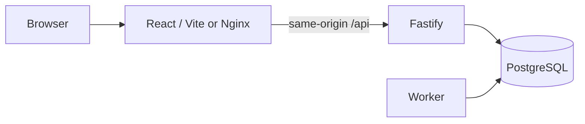

# Architecture

SeatWise is a TypeScript modular monolith with web, API, and worker processes and PostgreSQL persistence.

`packages/contracts` owns TypeBox request/response schemas. `/api/v1/openapi` exposes the generated API description. `packages/domain` is browser-safe and contains the clock contract and policy defaults, with no Node, database, or secret imports. `packages/db` owns database connections, migrations, and seed fixtures. `packages/test-support` provides isolated databases and a controllable clock. Web imports only contract types and browser-safe domain code.

Routes will validate and authorize, services will own transactions, and repositories will own parameterized SQL. Scheduling operations in later slices acquire the workspace lock before membership checks and entity locks. Resource exclusivity will be enforced through allocations and a GiST exclusion constraint in PR 4. No scheduling behavior is implemented in this foundation slice.

The migration process uses an owner principal. API and worker use a separate principal without schema creation, ownership, or access to migration metadata. Every tenant-owned table carries a workspace foreign key; resources expose a composite `(workspace_id, id)` unique key for later composite foreign keys. IDs are UUIDs; seeded IDs are stable for reproducibility. Desk capacity, hours bounds, and roles have database constraints.

An API connection timeout is 1.5 seconds, statement timeout is 5 seconds, and lock timeout is 2 seconds. Readiness returns a safe 503 when the database is unavailable; liveness is independent. The API owns and closes its pool on shutdown. Worker polling is bounded and shuts down its timer and pool on SIGINT/SIGTERM. No jobs are claimed yet.

No credentials, emails, headers, request bodies, or freeform domain content are logged. API logs use route templates, request IDs, status codes, and elapsed time. Future feature slices must preserve this boundary.
